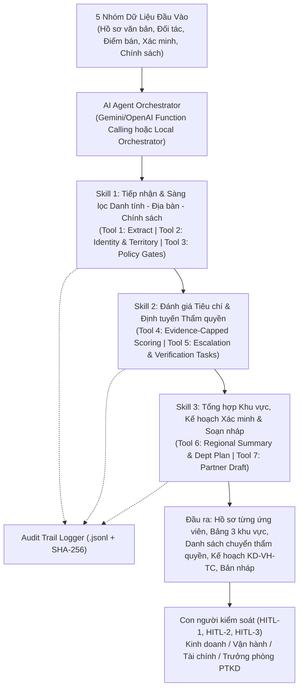

# TASK 1: PHÂN TÍCH QUY TRÌNH VÀ THIẾT KẾ HỆ THỐNG AI AGENT (ĐỀ 05)

**Đơn vị áp dụng:** Công ty Thiết bị Gia dụng Đại Thành (mạng lưới phân phối 3 khu vực; lưu lượng ~30 hồ sơ đối tác/tháng)  
**Người tiếp nhận kết quả cuối:** Trưởng phòng Phát triển Kinh doanh (PTKD)

---

## 1. Phân tích quy trình hiện tại (AS-IS)

Hiện tại, với khoảng **30 hồ sơ đối tác mỗi tháng**, Phòng Phát triển Kinh doanh xử lý theo chuỗi thủ công tuần tự:

| Bước | Tên bước | Thực hiện hiện tại | Đầu vào | Đầu ra / Trạng thái |
|---|---|---|---|---|
| **B1** | Tiếp nhận hồ sơ | Nhân viên PTKD nhận hồ sơ dạng văn bản (email, file đính kèm) gồm thông tin điểm bán, năng lực bảo hành, kế hoạch nhập hàng và yêu cầu hỗ trợ thương mại. | Hồ sơ ứng viên văn bản | Thư mục hồ sơ thô rời rạc |
| **B2** | Đọc & sơ kiểm thủ công | Nhân viên tự đọc từng hồ sơ, tự đối chiếu bằng mắt với danh sách đối tác hiện tại và điểm bán hiện có trên bảng tính. | Hồ sơ văn bản, DS đối tác & điểm bán hiện tại | Ghi chú sơ bộ dễ thiếu sót khi đổi tên/địa bàn |
| **B3** | Hỏi chéo các bộ phận | Nhân viên gửi email/chat hỏi lại từng bộ phận: **Kinh doanh** (trùng đối tác, vùng bảo hộ), **Vận hành** (mặt bằng, bảo hành), **Tài chính** (hạn mức, công nợ). | Câu hỏi rời rạc theo từng hồ sơ | Phản hồi không đồng bộ, kéo dài nhiều lượt hỏi lại |
| **B4** | Đánh giá & ưu tiên cảm tính | Nhân viên tổng hợp sơ bộ, thường ưu tiên các hồ sơ có **cam kết sản lượng nhập hàng cao** dù chưa có kết quả xác minh năng lực bảo hành hoặc đề xuất công nợ vượt chuẩn. | Thông tin tự khai + phản hồi rải rác | Danh sách chấm điểm thiếu chuẩn hóa |
| **B5** | Bàn giao cho Trưởng phòng | Trình Trưởng phòng PTKD danh sách đề xuất và xin ý kiến xử lý tiếp. | Danh sách tổng hợp thủ công | Thiếu căn cứ đối chiếu, sót điều kiện cần xác minh |

---

## 2. Xác định các vấn đề cốt lõi & ảnh hưởng cụ thể

Dựa trên bối cảnh thực tế tại Công ty Đại Thành, quy trình hiện tại tồn tại **4 vấn đề nghiêm trọng**:

1. **Vấn đề 1 — Sót đối tác trùng hệ thống và xung đột địa bàn bảo hộ**
   - *Biểu hiện:* Ứng viên được giới thiệu là "đối tác mới" nhưng thực chất đã thuộc hệ thống hiện tại (trùng pháp nhân/MST/SĐT hoặc đổi tên chi nhánh); điểm bán đăng ký nằm trùng địa bàn bảo hộ (cùng quận/phường hoặc trong bán kính bảo hộ) của đối tác đang hoạt động.
   - *Ảnh hưởng cụ thể:* Gây tự cạnh tranh nội bộ (cannibalization) trong cùng khu vực, vi phạm cam kết bảo hộ với đối tác hiện hữu, làm phát sinh khiếu nại/tranh chấp hợp đồng và mất thời gian thẩm định lại từ đầu khi đã đi sâu vào đàm phán.

2. **Vấn đề 2 — Thiên lệch theo cam kết sản lượng cao (Commitment Bias), thiếu bằng chứng năng lực phục vụ**
   - *Biểu hiện:* Các hồ sơ cam kết lượng mua cao thường được ưu tiên sớm dù chưa đủ bằng chứng xác minh về mặt bằng trưng bày và đặc biệt là **năng lực bảo hành thiết bị gia dụng** (nhân sự kỹ thuật, quy trình hậu mãi).
   - *Ảnh hưởng cụ thể:* Ngành thiết bị gia dụng phụ thuộc lớn vào lắp đặt và bảo hành tại nhà. Chọn nhầm đối tác yếu năng lực phục vụ sẽ làm tăng tỷ lệ khiếu nại khách hàng, ùn ứ bảo hành tại khu vực mới, hỏng uy tín thương hiệu Đại Thành và khiến doanh số cam kết ban đầu không đạt thực tế.

3. **Vấn đề 3 — Yêu cầu công nợ và hỗ trợ thương mại vượt chính sách nhưng không bị chặn từ đầu**
   - *Biểu hiện:* Hồ sơ đề nghị số ngày công nợ, hạn mức nợ hoặc tỷ lệ hỗ trợ trưng bày vượt trần chính sách vẫn đi tiếp hoặc chỉ phát hiện muộn khi hỏi lại Tài chính.
   - *Ảnh hưởng cụ thể:* Làm tăng rủi ro nợ xấu, đọng vốn lưu động, tạo tiền lệ phá vỡ khung chính sách thương mại thống nhất giữa 3 khu vực và gây bất bình đẳng giữa các đại lý.

4. **Vấn đề 4 — Phối hợp chéo bộ phận thủ công, thiếu nhật ký truy vết và không đồng nhất**
   - *Biểu hiện:* Với ~30 hồ sơ/tháng, nhân viên phải đánh giá từng hồ sơ rồi hỏi lặp đi lặp lại Kinh doanh, Vận hành, Tài chính; đầu ra bàn giao cho Trưởng phòng thiếu bảng phân loại rõ thông tin đã xác minh vs chưa xác minh.
   - *Ảnh hưởng cụ thể:* Kéo dài thời gian mở điểm bán mới, quá tải nhân sự PTKD ở khâu tổng hợp giấy tờ lặp lại, dễ bỏ sót các điều kiện phải xác minh và không có nhật ký truy vết khi cần kiểm tra lại lý do duyệt/loại.

---

## 3. Quy trình đề xuất (TO-BE)

Quy trình mới áp dụng mô hình **AI Agent điều phối đa kỹ năng kết hợp con người kiểm soát (Human-in-the-Loop)**:

| Bước | Tên bước | Đầu vào | Công việc thực hiện | Đầu ra | Người / Bộ phận chịu trách nhiệm |
|---|---|---|---|---|---|
| **B1** | Tiếp nhận & Chuẩn hóa hồ sơ | Hồ sơ ứng viên văn bản (`TXT`/`JSON`/`CSV`), mã ánh xạ schema | Đọc văn bản hồ sơ, trích xuất trường dữ liệu, giữ nguyên trích dẫn gốc (`evidence_quotes`), gắn kết quả xác minh hiện có và đánh dấu rõ trường bị thiếu. | Hồ sơ chuẩn hóa + danh sách trường thiếu (`missing_fields`) | **AI Agent** (tự động) & NV PTKD (kiểm tra file nạp) |
| **B2** | Đối chiếu danh tính & Địa bàn bảo hộ | Hồ sơ chuẩn hóa, DS đối tác hiện tại, DS điểm bán & chính sách địa bàn | Đối chiếu MST, SĐT, email, tên tương đồng (fuzzy match); tính khoảng cách Haversine (km) và đối chiếu Quận/Huyện/Phường bảo hộ. | Báo cáo trùng lặp danh tính & xung đột địa bàn | **AI Agent** (tự động) |
| **B3** | Kiểm tra điều kiện bắt buộc, Chính sách & Chấm điểm | Hồ sơ + kết quả đối chiếu B2 + Kết quả xác minh độc lập + Bộ tiêu chí & Chính sách công nợ | Kiểm tra cổng bắt buộc, chính sách công nợ/hỗ trợ, tách biệt *cam kết tự khai* với *bằng chứng đã xác minh* (kìm trần điểm phần chưa xác minh), chấm điểm 4 tiêu chí & phân loại (`Tiếp tục` / `Bổ sung` / `Chưa tiếp tục`). | Bảng điểm thực chứng vs tự khai, điều kiện chưa đạt, cờ chuyển thẩm quyền | **AI Agent** (tự động) |
| **B4** | Tổng hợp khu vực, Lập kế hoạch xác minh & Soạn nháp | Kết quả đánh giá toàn bộ 30 hồ sơ | Tổng hợp bảng đề xuất theo 3 khu vực, tách riêng danh sách ngoại lệ chuyển thẩm quyền, lập kế hoạch xác minh gửi 3 bộ phận và soạn bản nháp trao đổi từng đối tác. | Bảng đề xuất 3 khu vực, Kế hoạch phối hợp xác minh, Bản nháp phản hồi, Nhật ký `.jsonl` | **AI Agent** (tự động) |
| **B5** | Kiểm tra ngoại lệ & Phối hợp xác minh thực tế *(HITL-1 & HITL-2)* | Danh sách chuyển thẩm quyền & Kế hoạch phối hợp xác minh | **Kinh doanh** xác minh trùng lặp/địa bàn; **Vận hành** kiểm tra mặt bằng & KTV bảo hành; **Tài chính** thẩm định BCTC & điều chỉnh công nợ; cập nhật kết quả xác minh mới. | Kết quả xác minh bổ sung / Ý kiến xử lý ngoại lệ | **Bộ phận Kinh doanh, Vận hành, Tài chính** |
| **B6** | Phê duyệt cuối & Gửi phản hồi đối tác *(HITL-3)* | Bảng đề xuất 3 khu vực, hồ sơ chi tiết, phản hồi B5 và bản nháp trao đổi | Trưởng phòng PTKD rà soát căn cứ, chốt danh sách đối tác tiếp tục / bổ sung / từ chối, phê duyệt ngoại lệ (hoặc trình Ban Giám đốc) và cho phép gửi thư trao đổi. | Danh sách đối tác chính thức & Thư trao đổi đã gửi | **Trưởng phòng PTKD** & NV PTKD |

---

## 4. Các bước AI Agent tự thực hiện & lý do lựa chọn

Hệ thống giao cho AI Agent tự động hóa **4 bước cốt lõi (vượt mức tối thiểu 3 bước)**:

1. **Bước 1 — Đọc hiểu, trích xuất & chuẩn hóa hồ sơ văn bản (Skill 1 - Tool 1):**
   - *Lý do lựa chọn:* Hồ sơ đối tác gửi về có định dạng văn bản tự do không đồng đều; việc đọc tay ~30 hồ sơ/tháng dễ bỏ sót mã số thuế, số kỹ thuật viên bảo hành hoặc nhầm lẫn đơn vị tiền tệ (triệu/tỷ). Agent đọc trực tiếp văn bản, chuẩn hóa cấu trúc và lưu lại trích dẫn gốc để truy vết.
2. **Bước 2 — Đối chiếu danh tính đa chiều & kiểm tra xung đột địa bàn bảo hộ (Skill 1 - Tool 2):**
   - *Lý do lựa chọn:* Đối chiếu thủ công bằng mắt thường dễ bỏ qua các trường hợp đổi tên công ty nhưng trùng MST/SĐT, hoặc điểm bán khác tên đường nhưng nằm trong bán kính bảo hộ (ví dụ `<= 5.0 km`). Thuật toán chuẩn hóa tiếng Việt không dấu, fuzzy matching và công thức Haversine thực hiện chính xác 100% trong vài mili-giây.
3. **Bước 3 — Kiểm tra cổng điều kiện, chính sách công nợ & chấm điểm tách bạch cam kết/bằng chứng (Skill 1 Tool 3 + Skill 2 Tools 4–5):**
   - *Lý do lựa chọn:* Đây là điểm giải quyết trực tiếp thiên lệch cảm tính trong bối cảnh. AI Agent áp dụng nhất quán một bộ trọng số và ngưỡng chính sách cho mọi ứng viên, tự động giới hạn điểm phần chưa có bằng chứng xác minh độc lập và gắn cờ cảnh báo khi ứng viên "cam kết mua cao nhưng chưa kiểm chứng".
4. **Bước 4 — Tổng hợp báo cáo theo 3 khu vực, lập kế hoạch xác minh & soạn bản nháp trao đổi (Skill 3 - Tools 6–7):**
   - *Lý do lựa chọn:* Giảm 70–80% thời gian tổng hợp hành chính và soạn email lặp lại cho NV PTKD, đồng thời đảm bảo mọi câu chữ trong thư phản hồi bám sát 100% căn cứ và điều kiện chưa đạt đã được xác định.

---

## 5. Điểm con người kiểm tra / quyết định (Human-in-the-Loop), điều kiện chuyển xử lý & cách phát hiện lỗi

### 5.1. Các điểm Human-in-the-Loop (HITL) và điều kiện chuyển xử lý (Escalation Triggers)

| Điểm HITL | Người / Bộ phận quyết định | Điều kiện kích hoạt chuyển xử lý | Quyết định của con người |
|---|---|---|---|
| **HITL-1: Cổng Ngoại lệ Danh tính, Địa bàn & Chính sách** | **Bộ phận Kinh doanh**, **Bộ phận Tài chính**, **Trưởng phòng PTKD** | 1. `IDENTITY_DUPLICATE`: Trùng MST hoặc trùng SĐT/Email/tên tương đồng `>= 82%` với đối tác hiện tại. 2. `TERRITORY_CONFLICT`: Điểm bán cùng Quận/Phường bảo hộ hoặc khoảng cách GPS `<= 5.0 km`. 3. `POLICY_EXCEEDED`: Công nợ `> 30 ngày`, hạn mức `> 500 triệu`, hỗ trợ `> 5%`, hoặc nợ `> 300 triệu` chưa có xác minh tài chính. | Chốt giữ/hủy hồ sơ trùng; quyết định đổi địa điểm điểm bán hoặc cấp ngoại lệ vùng bảo hộ; phê duyệt ngoại lệ công nợ hoặc yêu cầu đối tác giảm về chuẩn chính sách. |
| **HITL-2: Xác minh Thực địa & Bằng chứng Năng lực** | **Bộ phận Vận hành**, **Kinh doanh**, **Tài chính** | 1. `MISSING_EVIDENCE`: Bất kỳ hạng mục bắt buộc nào (`pos_verified`, `warranty_verified`, `financial_verified`, `identity_verified`) có trạng thái `PENDING` hoặc `NOT_SUBMITTED`. 2. Đặc biệt cảnh báo `UNVERIFIED_HIGH_COMMITMENT` khi cam kết nhập `>= 400 triệu/tháng` nhưng thiếu bằng chứng thực tế. | Đi thực địa kiểm tra showroom, xác minh chứng chỉ kỹ thuật viên bảo hành, thẩm định BCTC, rồi cập nhật `verification_results` trước khi tái chấm điểm. |
| **HITL-3: Phê duyệt Danh sách & Duyệt Thư Trao đổi** | **Trưởng phòng PTKD** | Mọi danh sách phân loại theo khu vực (`Tiếp tục` / `Bổ sung` / `Chưa tiếp tục`) và mọi bản nháp email trước khi gửi ra ngoài. | Phê duyệt danh sách hợp tác tháng, ký duyệt hoặc chỉnh sửa câu chữ bản nháp trao đổi với đối tác. |

### 5.2. Cách phát hiện kết quả sai của AI Agent

1. **Truy vết ngược qua Nhật ký thực thi (`logs/*.jsonl`) & Trích dẫn gốc (`evidence_quotes`):** Kiểm tra từng sự kiện `TOOL_RESULT` để xác nhận giá trị trích xuất từ văn bản (`showroom_area_m2`, `warranty_technicians`, `requested_credit_days`) khớp 100% với câu trích dẫn trong hồ sơ gốc.
2. **Kiểm tra cờ bất nhất logic (Sanity & Invariant Checks):**
   - Nếu một hồ sơ có `claimed_score` cao nhưng `verified_score` thấp hơn nhiều -> kiểm tra lại trạng thái `verification_results` xem Agent có áp dụng đúng hệ số trần hay không.
   - Bất biến bắt buộc: không bao giờ có hồ sơ nào được xếp `Tiếp tục` nếu còn tồn tại bất kỳ mã `IDENTITY_DUPLICATE`, `TERRITORY_CONFLICT`, `POLICY_EXCEEDED`, hoặc `MISSING_EVIDENCE`.
3. **Kiểm thử biên định kỳ & rà soát chéo theo mẫu:** Chạy bộ kiểm thử tự động tại các giá trị biên (`30` vs `31` ngày, `500` vs `501` triệu, `5.0` vs `5.17` km) và Trưởng phòng kiểm tra xác suất 15–20% hồ sơ biên trước khi chốt.

---

## 6. Bản thiết kế hệ thống: Mục tiêu – Đầu vào – Quy trình – Đầu ra & Kiến trúc

### 6.1. Mục tiêu (Objective)
Xây dựng AI Agent đa kỹ năng hỗ trợ Phòng Phát triển Kinh doanh Công ty Đại Thành tự động sàng lọc, đối chiếu trùng lặp/địa bàn, thẩm định điều kiện & chính sách, chấm điểm dựa trên bằng chứng thực chứng và lập kế hoạch xác minh cho ~30 hồ sơ đối tác/tháng tại 3 khu vực; loại bỏ thiên lệch cam kết suông và đảm bảo mọi ngoại lệ đều chuyển đúng người có thẩm quyền kèm nhật ký truy vết đầy đủ.

### 6.2. Đầu vào (Inputs)
1. **Hồ sơ ứng viên (`applicants.json`/`.csv` + `dossiers/*.txt`):** Văn bản mô tả đối tác, điểm bán, bảo hành, kế hoạch nhập hàng, yêu cầu công nợ/hỗ trợ thương mại.
2. **Danh sách đối tác hiện tại (`existing_partners.csv`/`.json`):** Mã đối tác, tên, MST, người đại diện, SĐT, email, khu vực, trạng thái.
3. **Danh sách điểm bán hiện tại (`existing_pos.csv`/`.json`):** Địa bàn hành chính, tọa độ GPS (`lat`, `lon`), phạm vi và bán kính bảo hộ.
4. **Kết quả xác minh độc lập (`verification_results.csv`/`.json`):** Trạng thái xác minh danh tính, điểm bán, bảo hành, tài chính (`VERIFIED_PASS` / `VERIFIED_FAIL` / `PENDING` / `NOT_SUBMITTED`).
5. **Bộ quy tắc & ánh xạ cấu trúc (`config/rules_config.json`, `config/schema_mapping.json`):** Chính sách địa bàn, hạn mức công nợ, điều kiện bắt buộc, bộ tiêu chí trọng số và ánh xạ tên trường linh hoạt.

### 6.3. Quy trình & Kiến trúc lựa chọn (Architecture & Process)

**Kiến trúc lựa chọn: Hybrid Neuro-Symbolic Multi-Skill Agent (Tool-Calling Orchestrator + Deterministic Policy Engine + Audit Logger)**

*Lý do chọn kiến trúc Hybrid Neuro-Symbolic:*
- **LLM (Gemini / OpenAI Function Calling)** phát huy thế mạnh đọc hiểu ngôn ngữ tự nhiên tiếng Việt, tổng hợp giải trình và tinh chỉnh bản nháp giao tiếp đối tác.
- **Công cụ nghiệp vụ xác định (Deterministic Tools)** đảm nhận toàn bộ phép tính bán kính Haversine, đối chiếu MST/địa bàn, kiểm tra biên chính sách (`<=` vs `>`) và chấm điểm có kiểm soát bằng chứng — loại bỏ hoàn toàn rủi ro LLM "tính sai" hoặc "tự tin suy diễn cam kết thành đã xác minh".
- **Guardrail hoàn chỉnh chuỗi công cụ** đảm bảo dù ở chế độ LLM hay chế độ Offline Local, cả 3 kỹ năng và 7 công cụ đều chạy đủ, ghi log truy vết từng bước.

### 6.4. Đầu ra (Outputs)
1. **Hồ sơ đánh giá chi tiết từng ứng viên (`ket_qua_danh_gia.json` & Web UI):** Căn cứ trích xuất, điểm thực chứng vs tự khai, điều kiện chưa đạt, thông tin thiếu/chưa xác định, thông tin cần xác minh, đề xuất (`Tiếp tục` / `Bổ sung` / `Chưa tiếp tục làm việc`) và **bản nháp trao đổi với đối tác**.
2. **Bảng đề xuất đối tác theo 3 khu vực (`bang_de_xuat_khu_vuc.csv` & `bao_cao_tong_hop.md`):** Xếp hạng ưu tiên theo Miền Bắc, Miền Trung, Miền Nam.
3. **Danh sách riêng các trường hợp chuyển người có thẩm quyền:** Tách rõ *Xung đột địa bàn*, *Trùng hệ thống*, *Vượt chính sách*, *Cam kết cao thiếu bằng chứng*.
4. **Kế hoạch phối hợp xác minh (`ke_hoach_xac_minh.csv`):** Phân công cụ thể cho Bộ phận Kinh doanh, Vận hành, Tài chính.
5. **Nhật ký truy vết (`logs/<run_id>.jsonl`):** Lưu trữ mã băm SHA-256 dữ liệu đầu vào, lịch sử gọi công cụ, tham số, mã quy tắc kích hoạt và kết quả từng bước.

